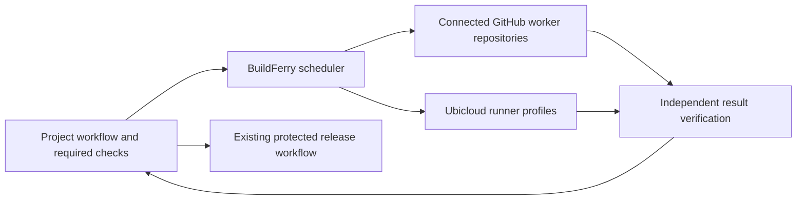

# BuildFerry MVP plan

BuildFerry will let a team connect its GitHub accounts, contribute a chosen amount of included CI capacity, and route builds and tests through those accounts or Ubicloud. Owners will manage budgets and fallback priorities from a self-hosted dashboard. Each project will retain its required checks, coverage requirements, and release approvals.

The first release targets one team operating one instance, with several projects and any configured number of consenting personal GitHub account owners. Concurrency and provider limits still bound usable capacity. GitHub is the initial source host; project commands remain independent of language or framework.

## Product boundaries

The MVP includes:

- A Docker deployment with persistent storage and a guided GitHub App setup.
- Connections to multiple personal GitHub accounts, their private CI repositories, and a Ubicloud project.
- Account usage, contributed-minute limits, personal reserves, and capacity reserved by running jobs.
- Ordered fallback tiers, balancing within a tier, concurrency limits, and job urgency.
- A stable source integration and centrally managed account and runner selection.
- Verified results for every required job, with logs linked to the actual provider run.
- Balanced test groups, merged coverage, cache-aware placement, cancellation of obsolete work, and reproducible performance comparisons.

Organization billing, additional source hosts, arbitrary cloud provisioning, public multi-tenant hosting, AI optimization, and automatic production deployments are outside this MVP. AWS CodeBuild integration follows later; the initial product must not disturb a project's existing manual AWS recovery path. Paid GitHub-hosted overflow is disabled in the initial presets.

GitHub bills hosted minutes to the repository owner. A reusable workflow or a different person triggering a run does not transfer the allowance. BuildFerry must dispatch work into a CI repository owned by the selected account. Standard hosted runners in public repositories are already free; route eligible public-project work there without consuming private-account contributions. Private source always requires private worker repositories. [GitHub Actions billing](https://docs.github.com/en/billing/concepts/product-billing/github-actions).

The provider-policy question for general cross-owner allowance sharing remains open. Before publicly promising that capability, clarify how the proposed worker repositories satisfy GitHub's project-association rules and relevant Actions terms. Continue product development without presenting successful technical dispatch as provider endorsement. [GitHub Actions terms](https://docs.github.com/en/site-policy/github-terms/github-terms-for-additional-products-and-features#actions).

## Self hosting and onboarding

Deploy one application container behind an HTTPS reverse proxy, with a persistent data volume. Use a TypeScript service, a React dashboard, and SQLite for the initial single-instance deployment. Serve the dashboard, API, webhook receiver, scheduler, and reconciliation loop from the same service. SQLite transactions provide the queue and reservation ledger; Redis and a separate broker are unnecessary for this scope.

Provide a Docker Compose example and a Coolify deployment guide. Initial configuration consists of the public URL, a secret encryption key supplied through the host's secret configuration, and the persistent volume. Runtime requirements are Linux, an HTTPS endpoint reachable by GitHub, and outbound access to provider APIs. CI commands execute on provider workers, never inside the dashboard container. Include health checks, readiness checks, versioned database migrations, backup and restore instructions, and an encrypted-credentials export policy. The encryption key must be backed up separately from the database.

The setup journey is:

1. Start the service and enter a one-use setup credential printed to the local server console. This grants a short-lived setup session before a GitHub App exists.
2. Select **Create GitHub App**. A manifest preconfigures permissions, callback URLs, and webhook events. Complete GitHub sign-in through the new app, bind the verified identity as the instance owner, and close installation claiming. Each self-hosted instance owns its own app and credentials. The app must support installation on the teammates' accounts; dashboard access remains restricted to invited users. [App manifests](https://docs.github.com/en/apps/sharing-github-apps/registering-a-github-app-from-a-manifest), [app visibility](https://docs.github.com/en/apps/creating-github-apps/registering-a-github-app/making-a-github-app-public-or-private).
3. Install the app on a selected source repository. BuildFerry inventories existing checks and proposes an integration PR. It does not merge that PR or change branch protection.
4. Invite an account owner through a short-lived, single-use invitation link. They sign in as themselves, authorize usage access, and create or select a private CI repository they own. Bootstrap its pinned worker workflow. Display the exact repository and account access before authorization.
5. The account owner confirms the allowance and billing period, the maximum contribution, a personal reserve, and permitted projects. A connection becomes eligible only after billing, ownership, workflow, and source-access probes succeed.
6. Select **Connect Ubicloud**. Guide the owner through Ubicloud's GitHub runner app installation, then securely enter a project API token in BuildFerry. Verify that the selected repository has runner access. Ubicloud currently documents token-based API authentication; do not invent a provider OAuth flow. [Ubicloud setup](https://www.ubicloud.com/docs/github-actions-integration/quickstart), [API authentication](https://www.ubicloud.com/docs/api-reference/overview).
7. Choose fallback priorities and budgets, preview a routing decision, and run a small validation job before enabling real work.

Normal GitHub onboarding must not require copying personal access tokens or private keys between repositories. Personal allowance access needs each owner's separate authorization with **Plan: Read**; repository installation alone is insufficient. Refresh expiring user authorizations, stop assignment on revoked access, and show a reconnect action. Confirm actual billing-period and allowance data availability during the initial API investigation; use owner-confirmed values where GitHub does not expose them. [Billing usage API](https://docs.github.com/en/rest/billing/usage#get-billing-usage-summary-for-a-user), [token refresh](https://docs.github.com/en/apps/creating-github-apps/authenticating-with-a-github-app/refreshing-user-access-tokens).

Automatic private-repository creation must be proven with the supported GitHub App permissions. The fallback setup is a guided browser step to create an empty private repository, followed by app installation and automatic worker provisioning. Neither path asks the owner to write YAML or exchange secrets manually.

## Dashboard controls

| View | Required controls and information |
| --- | --- |
| Overview | Queue, active work, connection health, contributed capacity, observed spend, estimated spend, and last billing refresh |
| Accounts | Link, pause, drain, reconnect, or remove an owner; allowance, contribution cap, reserve, billing period, allowed projects, and concurrency limit |
| Providers | Connect Ubicloud; verify installations; select supported runner sizes; configure rates and budget limits; show connection health |
| Routing | Ordered tiers, fixed order or shared allocation within a tier, account weights, queue wait limit, and permitted fallback providers |
| Jobs | Project, revision, attempt, urgency, selected account and runner, routing explanation, queue time, duration, logs, cancel, and retry |
| Performance | Time spent in setup, tests, builds, and cache transfer; slowest required path; aggregate compute minutes; observed and estimated cost |
| Access and history | Instance administrators, account owners, project viewers, and an audit history of credential, routing, and budget changes |

Instance administrators manage projects and routing. Account owners set their contribution ceiling, permitted projects, and personal reserve; an administrator cannot increase those limits without that owner's approval. Viewers can inspect authorized projects without seeing secrets or private usage details from unrelated repositories.

Pause stops new assignments. Drain stops new assignments while allowing existing work to finish. Remove drains by default and retains the configuration snapshot needed to verify active results. Revoked access stops assignments immediately; failed cancellation or verification remains visible.

## Priority and fallback behavior

Provider priority and job urgency are separate controls. Urgency changes queue order. It never changes the allowed providers, skips a check, or increases a budget. Prevent starvation by gradually raising the effective queue priority of waiting jobs.

Lower-numbered fallback tiers run first. A job can reach the next tier when the earlier tier has no eligible capacity or its configured wait limit expires. A failure in application code remains a failed check; it does not trigger repeated executions on other providers until something passes. Retry only classified infrastructure failures, at most once automatically, with a new reservation and complete audit trail.

The initial **Free minutes first** preset is:

| Tier | Candidate capacity | Allocation rule |
| --- | --- | --- |
| 1 | All connected, eligible GitHub included-minute accounts | Spread work according to remaining contributed capacity and configured weights |
| 2 | Ubicloud runner profiles | Use a compatible profile within explicit per-job and period budgets |
| Disabled | Paid GitHub overflow and AWS | Never selected by this preset |

An owner can put accounts into different tiers for a strict account order, or the same tier to share work. Within a shared tier, prevent concurrent jobs from spending the same remaining allowance. Apply cache affinity only among otherwise eligible candidates, without exceeding an owner's contribution or reserve.

Fit shorter independent jobs into an account's remaining capacity when a longer job cannot fit its enforced reservation. Account for upcoming allowance resets when balancing otherwise equivalent candidates. Each job type gets its own approved timeout bound; a short test group does not reserve the maximum duration of an entire build. This improves utilization without lowering required validation or assuming a job will finish early.

A separate **Faster feedback** policy can put a larger Ubicloud profile first for selected build jobs. It requires an explicit paid budget. Test jobs can retain the free-account policy. Preserve user-defined tier order: optimization may rank candidates within the selected tier or recommend a policy change, but cannot silently promote a lower tier.

If no candidate is allowed, show **Waiting for capacity** and keep required checks pending. When the configured overall deadline expires, fail the request visibly. Offer an administrator an explicit policy change or retry action. Never turn a capacity shortage into a skipped or successful check.

## Scheduling and budget accounting

The scheduler must perform these steps in order:

1. Load an authenticated request for an approved project and an immutable recipe revision. Determine required jobs, dependencies, source revision, resource requirements, timeouts, and allowed policies.
2. Reject candidates with the wrong owner, missing permissions, stale billing, unapproved worker revision, incompatible source visibility, unsupported CPU architecture, insufficient resources, unavailable runner access, or exhausted limits.
3. Read owner-wide usage for the applicable allowance period, including activity outside BuildFerry. Apply the owner's contribution cap and reserve. Treat allowance, BuildFerry contribution, storage charges, and provider credits as distinct quantities.
4. Select the highest eligible tier and rank candidates using remaining contributed capacity, configured weights, available concurrency, compatible cache history, and observed duration.
5. In one database transaction, acquire the job lease and reserve its maximum rounded billable duration. The reservation includes all worker jobs and any reporting overhead. The worker's actual timeout must enforce the same upper bound. An accepted provider dispatch with an uncertain response keeps its reservation until reconciled.
6. Dispatch once with a stable request identity. Record the owner, repository, worker version, recipe version, policy version, source revision, and provider run identity. Reconcile ambiguous responses before any retry or fallback to avoid duplicate spending.
7. Reconcile completion with job-level rounded durations. Retain completed but unsettled usage until it is accounted for in a consistent provider snapshot; do not release it merely because a completion webhook arrived. Prove the snapshot and reservation accounting against delayed and overlapping reports during the initial investigation. Conservative temporary overcounting is acceptable; claiming unverified available capacity is not.

Use standard Linux x64 GitHub-hosted workers for the first allowance adapter. Larger GitHub runners and other operating systems require separate billing logic and remain outside the free-minute pool. Do not apply outdated fixed operating-system minute multipliers. [GitHub billing and runner eligibility](https://docs.github.com/en/billing/concepts/product-billing/github-actions).

GitHub billing can lag and other workflows can spend concurrently. BuildFerry's admission policy cannot guarantee zero charges across an account. Require provider-side spending controls as the final backstop, show billing freshness, and stop native assignment when usage cannot be verified. Ubicloud cost admission uses configured, versioned rates and the actual selected runner tier. Reconcile estimates against provider billing where supported; label estimates when invoice data or promotional-credit balances are unavailable. Storage and network charges remain visible separately.

## Stable integration and protected results

Each project has a reviewed pipeline contract defining job names, commands, dependencies, scope rules, timeouts, resource requirements, artifact outputs, coverage rules, and allowed test splitting. A proposed location is `.buildferry/pipeline.yml`. Account identities, contribution limits, and fallback order belong in BuildFerry, outside that contract.

Pin the source integration and worker launcher to reviewed revisions. The contract used for execution must be approved, not arbitrary instructions supplied by an unreviewed PR or dashboard field. Changing the checks or worker implementation requires a reviewed version update. Routine account and routing changes require no source YAML edits. Already-running jobs retain their approved configuration snapshot when a new version is activated.

Initially preserve the existing check producer through a small trusted source workflow. The dispatcher creates the pending checks; BuildFerry dispatches workers and receives completion hints; the trusted result controller verifies results and completes the original checks. Do not leave a paid runner waiting or polling for the full build. Use signed webhooks and a bounded server-side reconciliation loop.

Verify the exact PR head, base and merge revision, original workflow and attempt, worker repository and revision, job identity, required steps, and an immutable checkout audit recorded before project code runs. A worker callback is a hint, not proof of success. Wrong revisions, missing steps, altered audits, missing test groups, expired artifacts, and stale attempts must never pass. Failed or obsolete requests cancel their workers where possible.

For the first project, retain the existing Quality, Build, SonarQube, database-validation, image-publication, and deployment dependencies. Keep the existing check names and trusted producer identity. A green workflow summary alone must not establish success while delegated checks remain pending. Test existing readiness readers and branch rules against this behavior. Main releases and production credentials stay in the original protected workflow; no production SQL or deployment occurs through BuildFerry.

Keep an explicit rollback setting that restores the project's established local or Ubicloud validation path. If dispatch is rejected before acceptance, the source integration may use that approved fallback. If dispatch acceptance is uncertain, recover or cancel it before starting another worker. After acceptance, a service outage keeps results pending until reconciliation or deadline failure. No outage may produce a false pass.

## Faster builds and tests

More accounts provide more independent machines. They do not combine memory or CPU for a single compiler process. Record mandatory resource floors separately from preferred profiles; retain a previously validated worker configuration until measurement supports a change.

The first performance work is:

1. Preserve the existing test selection and required coverage policy. Split only tests already required by that policy. Start with two independent groups, then compare four where capacity permits. Use historical suite durations to balance groups deterministically.
2. Require each selected test suite exactly once. Record expected groups and suite identities before execution. Missing, duplicated, failed, or cancelled groups block the aggregate gate. Merge coverage under the existing threshold and send one complete report to the existing SonarQube gate.
3. Build shared packages once where the dependency graph permits. Reuse only outputs keyed by source, dependency lockfile, toolchain, operating system, architecture, approved recipe, and trust boundary. Transfer packages as verified immutable artifacts when useful. Keep compiler caches and test-result evidence separate.
4. Initially use provider-native caches and verified package artifacts. Shared cross-provider compiler-cache storage is deferred until measurements show that transfer and storage costs justify it. Prevent cache reuse from untrusted jobs into trusted jobs.
5. Parallelize independent checks and profile builds only after proving dependencies. A large typecheck stays on one suitable worker. Benchmark the full required commands on standard GitHub workers and compatible Ubicloud profiles before recommending the faster policy.
6. Cancel superseded PR attempts and prioritize quick failure signals without dropping any required validation from successful runs.

Record queue delay, setup time, cache transfer, critical-path duration, rounded total compute minutes, and cost. Compare the same commit, commands, scope, and toolchain; distinguish cold and warm caches. Target at least a 25 percent reduction in median feedback time for test-heavy changes, then report actual results. Use at least ten matched warm observations before a median speed claim and twenty observations before presenting a p95 comparison. Paid speedups require the configured budget; sharding may increase total minutes through repeated setup, so compare both wall time and consumption.

## Security and operational requirements

- Keep GitHub App keys, owner billing authorizations, refresh tokens, and Ubicloud credentials encrypted at rest. Keep the encryption key outside the database. Never include them in project checkouts, command logs, public examples, or artifacts.
- Use repository-scoped, short-lived installation tokens for runtime operations. Worker source access is read-only and removed before executing project code. No worker receives the app private key, billing authorization, provider management token, or production secrets.
- Separate runtime permissions from bootstrap needs. Creating worker workflow files and opening integration PRs needs explicit Contents, Workflows, and Pull requests write capabilities in addition to runtime Actions and Checks access. GitHub App grants are app-wide; narrowly minted runtime tokens do not erase the registered app's broader authority. Explain those permissions during setup and avoid repository-administration or branch-bypass grants. Validate the minimum exact permission set in the first milestone.
- Authenticate service calls with GitHub Actions OIDC, checking issuer, audience, expiry, immutable repository and owner IDs, approved workflow identity and revision, run ID, attempt, and source context. Do not rely on a single legacy subject-string format. Grant each job access only to its own request and required artifacts. [GitHub OIDC](https://docs.github.com/en/actions/concepts/security/openid-connect).
- Verify webhook signatures and deduplicate delivery IDs. Use CSRF protection and secure expiring sessions for dashboard mutations. Restrict enrollment and administrative actions to authorized identities.
- Delegate same-repository trusted PRs first. Keep fork PRs and other untrusted events on their existing safe path. Their code must not receive private source credentials, privileged runner access, or trusted cache-write access.
- Use durable job states and renewable leases so restarts recover accepted work without dispatching it twice. Bound all network requests and retries, reconcile missed events, and persist deadlines. Snapshots retain the identities needed to verify jobs during account draining and worker upgrades.
- Ship a redacted audit trail, diagnostics export, credential rotation flow, retention controls, backup restore procedure, and upgrade instructions. Pin application images and worker actions to reviewed releases.

## Implementation structure

Keep the initial repository small:

| Area | Responsibility |
| --- | --- |
| Dashboard | Setup, accounts, routing, jobs, budgets, and performance views |
| Service | Authentication, GitHub App lifecycle, API, webhooks, and provider connections |
| Scheduler | Eligibility, priorities, reservations, job state, cancellation, and reconciliation |
| Providers | GitHub-hosted allowance execution and Ubicloud runner selection through GitHub Actions |
| Workers and integration | Pinned worker launcher, source dispatcher, result verifier, and test adapters |
| Persistence | Versioned SQLite migrations for identities, connections, policies, reservations, runs, artifacts, and audit events |

Ubicloud and standard GitHub workers share the GitHub Actions dispatch and result transport. Keep their billing and eligibility rules separate without duplicating that transport. Persist recipe and policy snapshots on each run rather than adding a generic plugin system or a general workflow language. Use TypeScript with validated boundary schemas. BuildFerry never imports the first adopting application's business code.

Prepare a container release, a working demo with synthetic data, setup and recovery guides, contribution instructions, a security-reporting policy, and an explicit open-source license before public release. The proposed default is Apache 2.0, subject to repository-owner selection. Keep private deployment details, account usage, credentials, and application-specific rollout evidence outside public examples.

## Milestones and acceptance

| Milestone | Deliverable | Required evidence |
| --- | --- | --- |
| 0 Provider investigation | Prove App registration, account usage authorization, private worker provisioning, source access, run correlation, cancellation, OIDC, and Ubicloud availability | Two consenting personal accounts and one Ubicloud connection complete isolated probes; document billing period, lag, settling, permission, and provider-policy assumptions |
| 1 Self hosting and dashboard | Container, persistent storage, installation claim, GitHub login, invitations, account connections, and read-only job and usage views | Fresh installation reaches a verified connection through the browser; restart and backup restore preserve configuration; unauthorized enrollment and secret disclosure tests pass |
| 2 Account and provider routing | Transactional reservations, owner contribution limits, ordered tiers, shared allocation, Ubicloud fallback, draining, and verified original checks | Work is assigned across at least three configured test accounts or equivalent fixtures; two real consenting owners execute isolated jobs; concurrency, outage, duplicate dispatch, cancellation, and stale-result scenarios retain correct gates |
| 3 Performance | Two and four test groups, complete coverage merge, compatible artifact reuse, and measured runner profiles | Every required suite and check is preserved; cold and warm comparison reports show actual feedback time, total minutes, and cost; budget limits remain enforced |
| 4 First project pilot | Reviewed integration PR, routing preview, opt-in traffic, rollback exercise, and release protection comparison | Existing check names, producer identity, readiness behavior, database release ordering, and production approvals remain effective; owner signs off before wider use |

Implement in this order. Use the existing reviewed cross-account bridge as a reference for dispatch, source audits, independent verification, and cancellation. Generalize those behaviors without publishing its private configuration. Do not move active workloads or credentials into BuildFerry while completing this planning milestone.

The first project rollout runs in observation mode, then routes one safe job, then a whole Build, and finally eligible test groups. Test low-allowance and provider-outage behavior explicitly. Keep source and worker recipes pinned throughout each trial. Validation uses PRs or dry runs and never manually invokes a production release. Approved merges continue to follow the original protected release automation.

## Required verification

Focused automated tests must cover:

- Multiple accounts with equal and unequal priorities, weights, contribution caps, reserves, different reset periods, and concurrent requests for the last available capacity.
- Owner-wide external usage, delayed and overlapping billing snapshots, unsettled completions, unknown prices, revoked access, and exhausted paid budgets.
- Lost dispatch responses, duplicate webhooks, delayed job visibility, restart recovery, lease expiry, missed callbacks, removal during a run, and bounded infrastructure retries.
- Wrong repositories or workflow revisions, forged or replayed OIDC tokens, altered audits, stale PR heads, changed attempts, fork events, and untrusted cache inputs.
- Test groups completing out of order, missing or repeated suites, failed groups, merged coverage parity, and an unchanged SonarQube threshold.
- A pending delegated check beside a skipped local job; aggregate readiness must remain blocked. Release workflow and environment protections must remain effective after fallback and rollback.
- Fresh self-hosting, browser setup, account reconnection, credential rotation, data backup and restore, and both desktop and mobile dashboard navigation.

BuildFerry's own CI must enforce typechecking, lint, meaningful tests, dependency and secret checks, and container startup verification. The adopter's current checks are additional requirements, not replaced by BuildFerry's tests. Performance evidence must come from comparable runs; account count and restored caches alone are not evidence of a faster pipeline.

## MVP completion

The MVP is ready when a fresh self-hosted installation can connect a project and multiple consenting owners, explain and execute budget-aware routing, use Ubicloud only under the configured policy, survive restarts and provider failures, and return complete verified results to the original checks. The pilot must demonstrate useful parallel execution and publish measured time and cost results while retaining every release protection.
